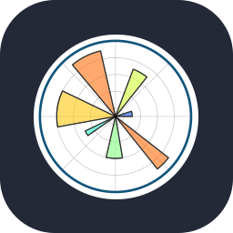
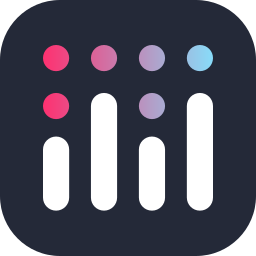

<h1 align="center">Hi, I'm Lev 👋</h1>

  <b>ML Engineer · <a href="https://www.kaggle.com/sigmaborov">2× Kaggle Master</a></b> 
  Mathematics & Computer Science at Central University

  
  
  
  

  <a href="./Kokovkin_Lev_ML_Resume.pdf">ML Resume (PDF)</a>

---

I work with computer vision, LLM fine-tuning, RAG and AI agents.
I also compete in ML and mathematics olympiads and present applied ML research.

### Tech stack

<table>
<tr>
<td><b>Languages & data</b></td>
<td>
  
  
  
  
  
  
 
Python · C++ · NumPy · pandas · Matplotlib · Plotly · SQL
</td>
</tr>
<tr>
<td><b>Machine learning & computer vision</b></td>
<td>
  
  
  
  
 
PyTorch · TensorFlow · scikit-learn · OpenCV · CatBoost · YOLO
</td>
</tr>
<tr>
<td><b>LLMs & NLP</b></td>
<td>
  
 
Hugging Face Transformers · LoRA / PEFT · NLTK · RAG · AI agents
</td>
</tr>
<tr>
<td><b>Environment & deployment</b></td>
<td>
  
  
 
Docker · Linux
</td>
</tr>
</table>

### Achievements

| Competition | Result |
| :--- | :--- |
| 🏅 **Kaggle** | **2× Master — Notebooks & Datasets**. Best Notebook rank: **93 / 60,807**. [Kaggle profile](https://www.kaggle.com/sigmaborov) |
| 🥇 **Stanford RNA 3D Folding** | Gold-medal notebook, **#1 by upvotes**. [Stanford notebook](https://www.kaggle.com/code/sigmaborov/stanford-rna-3d-folding-top-1-solution) |
| 🥉 **DLS ML Olympiad · MIPT** | **3rd / 502**, 2025 |
| 🌍 **IOAI national selection** | **Top 7**, 2026 |
| 🏆 **KFU Mathematics Olympiad** | Prize winner, 2025 |
| 🏆 **Rosatom CS Olympiad** | Prize winner, 2026 |

### Research

- **[PestCLEF / CLEF 2026](https://www.imageclef.org/PestCLEF2026):** 3rd on the final private leaderboard, macro-F1 **0.43992**. Presented in Jena, Germany.
- **[DLMMDD / ICANN 2026](https://e-nns.org/icann2026/deep-learning-and-mathematical-methods-for-deepfake-detection/):** synthetic image source attribution, **98.67%** private accuracy. Presented in Padua, Italy.
