

  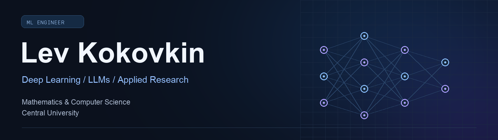

  
  &nbsp;
  

  <b>ML Engineer · Mathematics & Computer Science @ Central University</b> 
  Deep learning, LLM fine-tuning, RAG systems and AI agents. 
  Kaggle competitions, applied ML research and mathematics olympiads.

  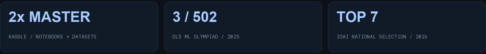

## 🏆 Achievements

| Competition / community | Achievement |
| :--- | :--- |
| **Kaggle** | **2× Master** — Notebooks & Datasets. Best Notebook rank: **93 / 60,807**. |
| **Stanford RNA 3D Folding** | **Gold-medal notebook**, ranked **#1 by upvotes**. |
| **DLS ML Olympiad · MIPT** | **3rd / 502** · 2025 |
| **International AI Olympiad · National selection** | **Top 7** · 2026 |
| **KFU Mathematics Olympiad** | **Prize winner** · 2025 |
| **Rosatom Computer Science Olympiad** | **Prize winner** · 2026 |

## 🔬 Research highlights

- **PestCLEF / CLEF 2026** — **3rd on the final private leaderboard**, macro-F1 **0.43992**. CPU-only relation extraction using a taxonomy-aware lexicon and gradient boosting. Presented in person in **Jena, Germany · September 2026**.
- **DLMMDD / ICANN 2026** — **98.67% private leaderboard accuracy** in synthetic image source attribution using post-processing-aware training. Presented in person in **Padua, Italy · September 2026**.

## 🧠 Tech stack

**Languages & environment**

  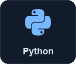
  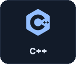
  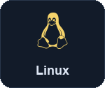

**SQL**

**Machine learning & computer vision**

  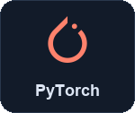
  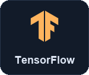
  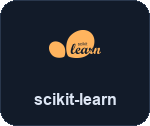
  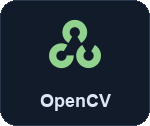

**CatBoost · YOLO · NLTK**

**Data & visualization**

  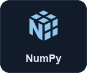
  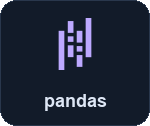
  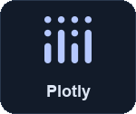

**Matplotlib**

**LLMs & tooling**

  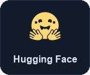
  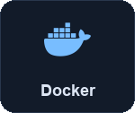

**LoRA · LLM fine-tuning · RAG · AI agents · Reinforcement learning**
